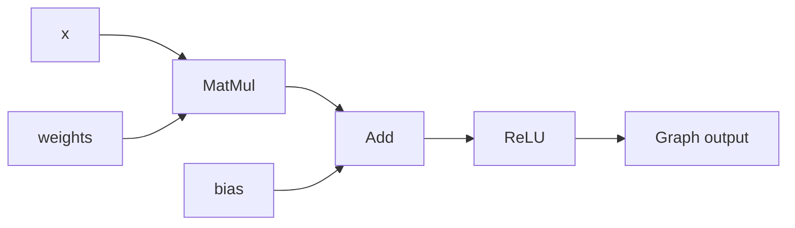

# TinyTensorCompiler

[](https://github.com/MZH006/TinyTensorCompiler/actions/workflows/ci.yml)

An educational C++17 tensor graph compiler and CPU interpreter. It represents computations as an intermediate representation (IR), finds dependency order, and rewrites eligible operation chains into fused operations while preserving numerical results and graph connections.

Built incrementally after a Python computational-graph prototype to explore compiler transformations, C++ ownership, and ML execution. The interpreter executes handwritten CPU loops with cached execution plans and reusable output buffers. A specialized source-code backend also emits standalone C++ for one fused linear/ReLU graph. Accelerator lowering is future work.

## Run it

Requires a C++17-capable Clang installation and Make. No external numerical libraries are required.

```sh
git clone https://github.com/MZH006/TinyTensorCompiler.git
cd TinyTensorCompiler
make run
make test
make test-ubsan
make test-asan  # Requires a working AddressSanitizer runtime; exercised by Linux CI.
make benchmark
```

If the repository is private, cloning requires an authorized GitHub account. See [BUILDING.md](BUILDING.md) for build details and file organization.

The example prints:

```text
Original order: MatMul Add ReLU
Optimized order: FusedLinearReLU
Original result: 14 0
Optimized result: 14 0
Outputs match: 1
```

## How it works

- **Tensor:** name, shape, optional float data, producer, and consumer registrations. Data is flat and row-major. Outputs can exist before numerical execution.
- **Operation:** input tensor pointers, an owned output tensor, and a virtual `execute()` method. Concrete operations implement Add, MatMul, ReLU, and fused computations.
- **Graph:** owns operations through `std::unique_ptr`, records one final output, and executes reachable operations in dependency order. Input tensors are caller-owned and must outlive the graph.
- **Codegen:** emits a standalone C++ program for a supported fused linear/ReLU graph, embedding weights/bias and reading runtime input values.
- **Optimizer:** matches contiguous chains in a topological order, invokes a pattern-specific builder, redirects consumers, updates the final graph output, disconnects old inputs, and substitutes the execution-order entries.

Graph connections are non-owning pointers. Each input use has a corresponding consumer registration; `Add(x, x)` registers two uses. DFS visits each operation once, placing dependencies before their consumers.



Two patterns share the same optimizer:

| Pattern | Replacement |
| --- | --- |
| `Add → ReLU` | `FusedAddReLU` |
| `MatMul → Add → ReLU` | `FusedLinearReLU` |

The example registers the longer rule first. Names, actual tensor connections, and intermediate consumer counts must agree. Each intermediate output must have exactly one consumer; the final matched output may have multiple users, all redirected during rewriting. This prevents removing shared intermediates. The linear builder handles either Add operand order.

Add requires equal shapes. MatMul supports two-dimensional matrices with matching inner dimensions. Bias currently has the full matrix-output shape; broadcasting is not implemented.

## Correctness and CI

`make test` runs 19 named test groups, including 32 seeded numerical cases compared with a double-precision reference using absolute and relative tolerances. Coverage includes final-output fusion, rectangular matrices, branch safety, repeated inputs, downstream rewiring, invalid shapes, missing data, matcher boundaries, multiple matches, repeated optimization, changed inputs, zero-sized dimensions, pointer stability as ownership storage grows, execution-plan reuse/invalidation, and stable output buffers with changed inputs.

The main Linux CI job builds on Ubuntu 24.04 and runs the C++ tests, importer checks, UndefinedBehaviorSanitizer, AddressSanitizer with leak detection, and the example. A separate PyTorch job runs numerical, FX import, and standalone code-generation validation. Sanitizer targets compile separate executables. Tests require assertions and reject `NDEBUG` builds. The workflow and its latest result are linked above. Local macOS AddressSanitizer previously failed during runtime initialization; use the Linux run to check that configuration.

## PyTorch numerical validation

An optional Python validator compares the fixed computation `ReLU(x @ weights + bias)` against CPU float32 PyTorch. A C++ command-line runner builds the graph and executes either the original operations or the fused replacement. It accepts numerical inputs; it does not import arbitrary PyTorch graphs.

With Python 3.12 and PyTorch available:

```sh
python3 -m pip install -r requirements-validation.txt
make test-pytorch
```

Linux CPU-only installation can use `--index-url https://download.pytorch.org/whl/cpu`; see the [official PyTorch installation commands](https://pytorch.org/get-started/previous-versions/#v291). The dependency file pins PyTorch 2.9.1, which was used for local validation. Core builds and C++ tests do not require Python or PyTorch.

The validator runs 34 input cases in both modes, giving 68 comparisons against PyTorch, plus seven invalid-request checks. Cases include the original example, zero activations, eight matrix shapes, seeded random data, and reversed Add operands. It verifies the output shape, element count, and operation count (three unfused, one fused), then compares values with `rtol=1e-4` and `atol=1e-5`. Each subprocess has a 30-second timeout. A separate Linux CI job runs this validation with Python 3.12 and CPU PyTorch.

The runner's standard input contains `M K N`, followed by row-major x, weight, and bias values. Dimensions must be in `[1, 256]`; bias has shape `[M,N]`. For example:

```sh
make linear-runner
./linear-runner --fused <<'EOF'
1 2 2
1 2
3 4 5 6
1 -20
EOF
```

Successful standard output is JSON:

```json
{"shape":[1,2],"operation_count":1,"data":[14,0]}
```

Use `--unfused` to execute three operations or append `--reverse-add` to swap Add's inputs. Errors go to standard error with exit status 1. The runner rejects malformed/truncated input, nonfinite values, out-of-range dimensions, and trailing tokens.

## Benchmark

`make benchmark` compiles all benchmark sources with `-O3`. Separate fused and unfused graphs share identical seeded inputs. The fused graph is optimized before its first execution. Shapes and output equivalence are checked before timing.

Each graph is warmed up, then measured in 21 batches of 50 executions. Measurement order alternates between graphs. The reported time is the median batch-average microseconds per execution. Construction and optimization are excluded. Current execution caches DFS order after the first run; numerical loops and execution overhead remain included. Current kernels reuse their output storage after first execution. The historical measurements below predate execution-plan caching and included DFS traversal on every run.

One local run on macOS arm64 with Apple Clang 15.0.0, recorded October 11, 2026:

| M × K × N | Unfused µs | Fused µs | Unfused / fused | Intermediate tensor bytes avoided |
| --- | ---: | ---: | ---: | ---: |
| 8 × 16 × 8 | 2.896 | 2.079 | 1.393× | 512 |
| 32 × 64 × 32 | 35.337 | 34.011 | 1.039× | 8,192 |
| 64 × 128 × 64 | 280.151 | 280.413 | 0.999× | 32,768 |

These are illustrative results from one run, not portable performance guarantees. Timings vary between runs; larger cases have been close to parity. This implementation retains the same naive matrix-multiplication algorithm, so graph fusion does not establish an optimized matrix kernel.

Bytes avoided are calculated as `2 * M * N * sizeof(float)`: the MatMul and Add intermediate tensor payloads eliminated from execution. This is not measured process memory, peak allocation, or memory traffic. Detached operations remain owned until Graph destruction; data from execution before optimization can remain allocated. Benchmarks avoid that case by optimizing before first execution.

## Current boundaries and next steps

The supported model is a valid DAG with finite float data and one graph output. Matching depends on adjacency in a particular topological order. There is no cycle detection, general tensor broadcasting, allocation-failure recovery, or reclamation of detached operations. Overflow checks exist in text declarations, writable-storage allocation, and code generation, but are not comprehensive: Tensor constructors, `setData()`, and operation output-shape calculations still require shapes with representable element counts. Custom rewrite builders are expected to return valid replacements and terminating rules.

The experimental FX exporter supports a small concrete subset of PyTorch graphs, described below. Next steps include broader import/code-generation support, lifetime-based sharing of buffers between tensors, and MLIR lowering. MLIR integration, device execution, and Tenstorrent hardware support are not implemented yet.

## Experimental FX graph import

```sh
make graph-import
./graph-import example.graph
python3 scripts/export_fx.py /tmp/model.graph --inputs /tmp/inputs.txt
./graph-import /tmp/model.graph /tmp/inputs.txt
make test-import
make test-fx
```

The exporter uses [torch.fx symbolic tracing](https://docs.pytorch.org/docs/2.9/fx.html) to read model structure. `export_graph(model, inputs)` returns text; the CLI exports a small demonstration model. Model tensor attributes are embedded as constants; placeholders become fixed-shape runtime inputs. Example inputs validate export shapes and supported operations, while their values are written separately with `export_inputs(graph_text, inputs)`. This supports reusable models within the small supported subset, not a general PyTorch compiler. Only trusted Python models should be traced: tracing executes Python model code.

Supported tensors are nonempty rank-two strided CPU float32 tensors. Supported operations are positional `operator.matmul`/`torch.matmul`, `operator.add`/`torch.add`/tensor `.add()`, and `torch.relu`, with one tensor output. Addition requires identical shapes. Scalar operands, broadcasting, keyword arguments, other methods/modules/functions, and multiple outputs are rejected. Symbolic tracing itself has limitations, including data-dependent Python control flow.

Text declarations use `input name rows columns` for runtime inputs and `tensor name rows columns data...` for constants, followed by `matmul out lhs rhs`, `add out lhs rhs`, `relu out input`, and one `output name`. Names must be defined before use and cannot be redefined. Blank lines are allowed; comments are not supported. The importer checks syntax, finite tensor data, positive dimensions, dimension-product overflow for declarations, duplicate names, and operation shapes. Graph-instruction errors include line numbers; errors exit with status 1. Input-data errors currently identify the input name but do not include a line number.

For graphs without runtime inputs, the importer executes before and after fusion and compares finite values with `atol=1e-5`, `rtol=1e-4`. Output uses float32 round-trip precision. `make test-import` covers the example, an input-only graph, 15 invalid graph files, repeated execution, and five invalid second-run input files. `make test-fx` exports eight seeded rectangular graphs (including reversed Add inputs), runs each optimized graph with two input files in one C++ process, compares all 16 results with PyTorch, checks fusion to one operation, and rejects ten unsupported exports and three invalid Python input serializations. Both targets are included in Linux CI; workflow changes require pushing before CI runs them.

For runtime models, use `./graph-import model.graph first.txt second.txt`. The graph is parsed and optimized once, then executed for each input file. Each file supplies `name data...` lines for every declared input, exactly once, with the declared number of finite float values. Unknown names, duplicates, missing data, and extra values are rejected; omission in a later file cannot reuse a previous run's data. Constant-only models retain the original one-file invocation. Input shapes remain fixed across runs. Runtime execution prints one `Result:` line per file and does not run an unfused reference; the FX validator supplies the independent PyTorch reference.

## Cached execution plans

`Graph::execute()` builds and stores the reachable operation order on first use. Repeated executions and `Tensor::setData()` reuse that plan. Changing the output or adding an operation invalidates the graph's plan. Producer changes, input replacement, and input disconnection advance a shared topology revision, so raw-pointer rewrites also force a rebuild on the next execution. This conservative mechanism can invalidate plans in unrelated graphs; construction, mutation, and execution are single-threaded. `getExecutionOrder()` remains a fresh traversal for inspection and optimization. `getPlanBuildCount()` exposes rebuilds for correctness tests. Add, MatMul, ReLU, FusedAddReLU, and FusedLinearReLU fill output tensors through `getWritableData()`: storage is allocated on first execution and reused on later runs. Callers must overwrite all elements without resizing the returned vector. MatMul starts each reduction from zero, including zero-length reductions. Tests check stable output addresses and updated values across sign changes and repeated executions. Sharing buffers between different tensors is not implemented.

A before/after comparison of execution-plan caching and buffer reuse is recorded in [the benchmark report](benchmarks/execution-reuse-2026-10-12.md), with all raw round medians in the adjacent JSON file. The small case improved; larger cases remained near parity or varied between runs. These measurements combine both changes.

## Experimental standalone C++ generation

```sh
make graph-import
python3 scripts/export_fx.py /tmp/model.graph --inputs /tmp/inputs.txt
./graph-import --emit-cpp /tmp/model.graph /tmp/generated.cpp
clang++ -std=c++17 -Wall -Wextra -O3 /tmp/generated.cpp -o /tmp/generated
printf '1 2\n' | /tmp/generated
make test-codegen
```

The first backend supports a graph that optimizes to exactly one `FusedLinearReLU`, with exactly one declared runtime input for x and finite embedded weights/bias. Shapes must be nonempty and fixed. Other graphs are rejected. The generated program reads exactly M*K raw finite floats from standard input (without the input name used by importer data files), then prints M*N row-major floats. It requires no project headers, graph objects, virtual dispatch, or compiler runtime. Each invocation allocates its own vectors and executes once; it does not provide the interpreter's multiple-input-file protocol. Weights and bias are float32 literals written with round-trip precision and a fixed locale.

`make test-codegen` exports six models with rectangular shapes and both Add operand orders, generates and compiles each source alone with warnings as errors, compares two inputs per executable against PyTorch, checks 18 malformed runtime inputs, and rejects an unsupported graph without creating a source file. The PyTorch CI job includes this target after the workflow is pushed. This is a specialized source-code backend, not MLIR lowering or a general native-code compiler.
